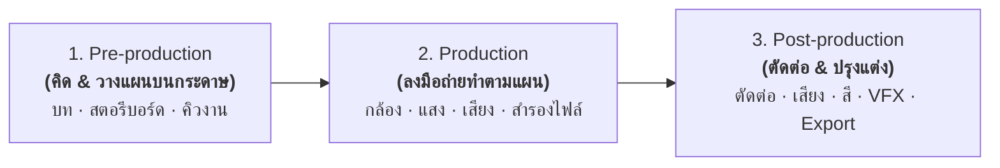

# 31905-2016 การตัดต่อภาพวิดีทัศน์ดิจิทัลและวิชวลเอฟเฟกต์
### *(Digital Video Editing and Visual Effect)*

[](lessons/01-ความรู้เบื้องต้นเกี่ยวกับสื่อดิจิทัล.md)
[](lessons/01-ความรู้เบื้องต้นเกี่ยวกับสื่อดิจิทัล.md)
[](https://lbtech.ac.th)
[](https://lbtech.ac.th)
[](lessons/01-ความรู้เบื้องต้นเกี่ยวกับสื่อดิจิทัล.md)
[](https://www.adobe.com/)
[](LICENSE)

คลังเนื้อหาการเรียนรู้ เอกสารประกอบการสอน สรุปเนื้อหาบทเรียน และโจทย์การบ้านภารกิจ รายวิชา **31905-2016 การตัดต่อภาพวิดีทัศน์ดิจิทัลและวิชวลเอฟเฟกต์ (Digital Video Editing and Visual Effect)** หลักสูตรประกาศนียบัตรวิชาชีพชั้นสูง (ปวส.) พุทธศักราช 2567 หมวดวิชาสมรรถนะวิชาชีพเฉพาะ แผนกวิชาเทคโนโลยีคอมพิวเตอร์ วิทยาลัยเทคนิคลพบุรี

---

## 📌 สารบัญด่วน (Quick Navigation)

- [📑 บทเรียนที่ 1: ความรู้เบื้องต้นเกี่ยวกับสื่อดิจิทัล (Digital Media Fundamentals, CG, VFX, 3D, AR/VR, Hardware)](lessons/01-ความรู้เบื้องต้นเกี่ยวกับสื่อดิจิทัล.md)
- [📝 สรุปกระบวนการผลิต 3P: Pre-production · Production · Post-production](lessons/01-ความรู้เบื้องต้นเกี่ยวกับสื่อดิจิทัล.md#สรุปจำง่าย-3-ขั้นตอนการผลิตสื่อ-pre-production--production--post-production)
- [📝 การบ้าน บทที่ 1: งานนำเสนอทบทวนสื่อดิจิทัล (5 ภารกิจ · สไลด์ 6–8 หน้า · 20 คะแนน)](assignments/การบ้าน-บทที่-1-ทบทวนสื่อดิจิทัลก่อนบทที่-2.md)
- [📥 ดาวน์โหลดโจทย์การบ้านฉบับทางการ (PDF)](assignments/การบ้าน-บทที่-1-งานนำเสนอทบทวนสื่อดิจิทัล-(โจทย์).pdf)

---

## 🎯 ข้อมูลพื้นฐานของรายวิชา

| รายการ | รายละเอียด |
| :--- | :--- |
| **รหัสวิชา** | `31905-2016` |
| **ชื่อวิชา (ไทย)** | การตัดต่อภาพวิดีทัศน์ดิจิทัลและวิชวลเอฟเฟกต์ |
| **ชื่อวิชา (อังกฤษ)** | Digital Video Editing and Visual Effect |
| **ท-ป-น** | 1-4-3 (ทฤษฎี 1 คาบ · ปฏิบัติ 4 คาบ · รวม **3 หน่วยกิต**) |
| **ระดับการศึกษา** | ประกาศนียบัตรวิชาชีพชั้นสูง (ปวส.) ชั้นปีที่ 2 |
| **กลุ่มเรียนที่เกี่ยวข้อง** | 2สทค2 (วันศุกร์ คาบ 1–4 เวลา 08.00–12.00 น. ห้อง TC201 และคาบ 5 ห้อง TC202) |
| **ครูผู้สอนหลัก** | ครูรณภูมิ นาคสมบูรณ์ (หัวหน้าแผนกวิชาเทคโนโลยีคอมพิวเตอร์) |
| **ผู้ร่วมจัดทำสื่อ** | ครูฝึกสอน 2 (นักศึกษาฝึกประสบการณ์วิชาชีพครู แผนกวิชาเทคโนโลยีคอมพิวเตอร์) |

---

## 🎬 หัวใจสำคัญของกระบวนการผลิตสื่อดิจิทัล (The 3P Workflow)



> [!TIP] จำง่ายใน 1 ประโยค
> **"Pre คือวางแผนบนกระดาษ $\rightarrow$ Pro คือออกไปถ่ายทำ $\rightarrow$ Post คือนำมาตัดต่อให้สมบูรณ์"**

---

## 📂 โครงสร้างไดเรกทอรี (Repository Structure)

```
31905-2016-digital-video-editing-vfx/
├── README.md                               # หน้าหลักสรุปข้อมูลรายวิชาและสารบัญ
├── LICENSE                                 # สัญญาอนุญาตโอเพนซอร์ส (MIT License)
├── .gitignore                              # ละเว้นไฟล์ขยะและแคชโปรแกรมตัดต่อ
│
├── lessons/                                # คลังเนื้อหาบทเรียนทฤษฎีและปฏิบัติ
│   └── 01-ความรู้เบื้องต้นเกี่ยวกับสื่อดิจิทัล.md   # บทที่ 1 ฉบับสมบูรณ์ (สื่อดิจิทัล, ฮาร์ดแวร์ 9 กลุ่ม, 3P)
│
└── assignments/                            # คลังโจทย์การบ้านและแบบฝึกหัด
    ├── การบ้าน-บทที่-1-ทบทวนสื่อดิจิทัลก่อนบทที่-2.md   # รายละเอียด 5 ภารกิจ กติกา และ Rubric 20 คะแนน
    └── การบ้าน-บทที่-1-งานนำเสนอทบทวนสื่อดิจิทัล-(โจทย์).pdf # เอกสารโจทย์ฉบับพิมพ์ PDF
```

---

## 👨‍🏫 บุคลากรผู้รับผิดชอบรายวิชา

- **ครูผู้สอนหลัก:** ครูรณภูมิ นาคสมบูรณ์ (วทม.เทคโนโลยีสารสนเทศ / หัวหน้าแผนกวิชาเทคโนโลยีคอมพิวเตอร์)
- **ผู้เรียบเรียงและพัฒนาคลังสื่อการสอน:** นักศึกษาฝึกประสบการณ์วิชาชีพครู 2 (ครูฝึกสอน 2) สาขาวิชาเทคโนโลยีคอมพิวเตอร์
- **หน่วยงาน:** แผนกวิชาเทคโนโลยีคอมพิวเตอร์ วิทยาลัยเทคนิคลพบุรี สังกัดสำนักงานคณะกรรมการการอาชีวศึกษา (สอศ.)

---

## 📜 สิทธิ์การใช้งาน (License)

เนื้อหา สื่อการสอน และโจทย์การบ้านทั้งหมดในคลังนี้เผยแพร่ภายใต้สัญญาอนุญาต [MIT License](LICENSE) สามารถนำไปใช้เพื่อประโยชน์ทางการศึกษา การค้นคว้าวิจัย และการจัดการเรียนการสอนได้อย่างอิสระ
