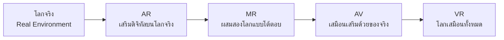
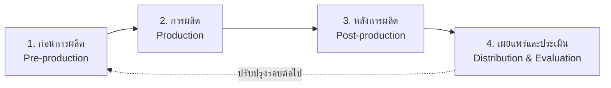
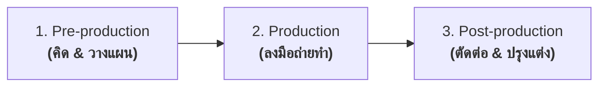

---
title: บทที่ 1 - ความรู้เบื้องต้นเกี่ยวกับสื่อดิจิทัล
aliases:
  - บทที่ 1 สื่อดิจิทัล
  - Digital Media เบื้องต้น
  - ความรู้พื้นฐานสื่อดิจิทัล
tags:
  - การสอน
  - เนื้อหาบทเรียน
  - สื่อดิจิทัล
  - DigitalMedia
  - VFX
  - 3D
  - Animation
  - AR
  - VR
course_code: 31905-2016
course_title: การตัดต่อภาพวิดีทัศน์ดิจิทัลและวิชวลเอฟเฟกต์
unit: 1
week: 1
created: 2026-10-30
updated: 2026-10-30
status: ฉบับร่าง
---

# บทที่ 1: ความรู้เบื้องต้นเกี่ยวกับสื่อดิจิทัล (Introduction to Digital Media)

> [!abstract] ภาพรวมบทเรียน
> บทนี้วางพื้นฐานก่อนลงมือตัดต่อจริง ตั้งแต่ความหมายของ **สื่อดิจิทัล** องค์ประกอบและประเภทของสื่อ งานสร้างสรรค์ที่เกิดจากสื่อดิจิทัล (VFX, Digital Art, Animation, Computer Graphics, AR, VR) ไปจนถึง **เครื่องมือ–อุปกรณ์** และ **กระบวนการผลิต** ที่ใช้ในงานอาชีพ
> เรียนจบแล้วนักศึกษาต้องตอบได้ว่า "งานแต่ละชิ้นคืออะไร ใช้เครื่องมืออะไร และผลิตตามลำดับขั้นใด"

> [!info] ผลลัพธ์การเรียนรู้
> 1. อธิบายความหมายและความต่างของสื่อดิจิทัลกับสื่อดั้งเดิมได้
> 2. แยกองค์ประกอบและประเภทของสื่อดิจิทัลได้ถูกต้อง
> 3. บอกความแตกต่างของ CG, Digital Art, Animation, VFX, AR และ VR ได้
> 4. เลือกเครื่องมือและอุปกรณ์ให้เหมาะกับงานแต่ละประเภทได้
> 5. อธิบายกระบวนการผลิตสื่อดิจิทัลครบ 4 ระยะได้

---

## 1. สื่อดิจิทัล (Digital Media) คืออะไร

### 1.1 ความหมาย

**สื่อ (Media)** คือช่องทางหรือตัวกลางที่ใช้ส่งสารจากผู้ส่งไปยังผู้รับ เช่น ป้าย หนังสือ วิทยุ โทรทัศน์

**ดิจิทัล (Digital)** คือการแทนข้อมูลทุกชนิดด้วยตัวเลขฐานสอง (`0` กับ `1`) ทำให้เครื่องคอมพิวเตอร์สร้าง จัดเก็บ แก้ไข คัดลอก และส่งต่อได้โดยไม่สูญเสียคุณภาพ

> [!note] นิยามที่ใช้ในวิชานี้
> **สื่อดิจิทัล = สื่อที่ถูกสร้าง จัดเก็บ ประมวลผล และนำเสนอด้วยเทคโนโลยีดิจิทัล ผ่านอุปกรณ์อิเล็กทรอนิกส์** ไม่ว่าจะเป็นสมาร์ทโฟน คอมพิวเตอร์ จอแสดงผล แว่น VR หรือระบบเครือข่าย

คำว่า "ดิจิทัล" ไม่ได้หมายถึง "ทันสมัย" แต่หมายถึง **ข้อมูลถูกแปลงเป็นรหัสดิจิทัล** — รูปถ่ายที่ถ่ายด้วยกล้องดิจิทัลและเก็บเป็นไฟล์ `.jpg` คือสื่อดิจิทัล ขณะที่รูปถ่ายอัดกระดาษคือสื่อดั้งเดิม แม้ภาพเดียวกัน

### 1.2 สื่อดั้งเดิม vs สื่อดิจิทัล

| ประเด็น          | สื่อดั้งเดิม (Analog)               | สื่อดิจิทัล (Digital)               |
| :--------------- | :---------------------------------- | :---------------------------------- |
| การเก็บข้อมูล    | ต่อเนื่อง (ความต่อเนื่องทางฟิสิกส์) | ไม่ต่อเนื่อง (ชุดตัวเลข 0/1)        |
| การคัดลอก        | คุณภาพลดลงทุกครั้ง                  | คัดลอกกี่ครั้งก็ได้คุณภาพเดิม       |
| การแก้ไข         | แก้ยาก ต้องทำใหม่                   | แก้ไขซ้ำได้ไม่จำกัด                 |
| การค้นหา         | ต้องเปิดดูทีละหน้า                  | ค้นหา/ติดแท็ก/จัดหมวดได้            |
| การส่งต่อ        | ต้องขนย้ายทางกายภาพ                 | ส่งผ่านเครือข่ายได้ทันที            |
| การวัดผล         | วัดยาก                              | วัดได้ด้วยตัวเลข (view, watch time) |
| การเข้าถึง       | จำกัดตามสถานที่                     | เข้าถึงได้ทุกที่ที่มีอินเทอร์เน็ต   |
| ต้นทุนการทำสำเนา | สูง                                 | เกือบเป็นศูนย์                      |

### 1.3 ลักษณะเด่น 7 ประการของสื่อดิจิทัล

1. **แก้ไขและทำซ้ำได้ (Editable & Reproducible)** — ไฟล์ต้นฉบับเสียหายได้ยาก และแก้ไขได้โดยไม่ต้องเริ่มใหม่
2. **โต้ตอบได้ (Interactive)** — ผู้ชมกด เลือก ลาก หรือควบคุมเนื้อหาได้ ไม่ใช่ดูทางเดียว
3. **ไม่เป็นเส้นตรง (Non-linear)** — ผู้ชมเลือกเส้นทางการรับชมเองได้ เช่น คลิกบทในอีเลิร์นนิง
4. **รวมหลายสื่อ (Multimedia)** — ข้อความ ภาพ เสียง วิดีโอ อยู่รวมกันในชิ้นงานเดียว
5. **วัดผลได้ (Measurable)** — เก็บข้อมูลการเข้าชมได้จริง ใช้วางแผนงานครั้งต่อไป
6. **ปรับขนาดได้ (Scalable)** — ไฟล์เดียวแสดงผลได้ทั้งมือถือ แท็บเล็ต และจอใหญ่
7. **ค้นหาและจัดระเบียบได้ (Searchable & Tagged)** — ใช้ metadata ในการจัดการคลังสื่อ

### 1.4 ข้อจำกัดที่ต้องรู้

> [!warning] อย่ามองข้าม
> - **ต้องพึ่งพาเทคโนโลยี** — ไฟล์เสีย อุปกรณ์พัง หรือแบตหมด = ใช้งานไม่ได้
> - **ปัญหาลิขสิทธิ์** — คัดลอกง่ายจึงละเมิดง่าย
> - **ข่าวปลอมและ AI สร้างภาพ** — ตรวจสอบความถูกต้องได้ยากขึ้น
> - **ช่องว่างการเข้าถึง (Digital Divide)** — ไม่ใช่ทุกคนมีอุปกรณ์หรืออินเทอร์เน็ต
> - **ขยะข้อมูล (Data Bloat)** — ไฟล์วิดีโอกินพื้นที่มหาศาล ต้องมีระบบจัดเก็บที่ดี

---

## 2. องค์ประกอบของสื่อดิจิทัล

สื่อดิจิทัล 1 ชิ้น ไม่ได้เกิดจากไฟล์เดียว แต่ประกอบขึ้นจาก **3 มุมมอง** ที่ต้องมองพร้อมกัน

### 2.1 ภาพรวม: สามมุมมองขององค์ประกอบ

| มุมมอง | ตอบคำถามอะไร | ตัวอย่าง |
| :--- | :--- | :--- |
| **ด้านเนื้อหา (Content)** | ในชิ้นงานมีสื่ออะไรบ้าง | ข้อความ ภาพ เสียง วิดีโอ 3D |
| **ด้านระบบ (System)** | อะไรทำให้ชิ้นงานทำงานได้ | ฮาร์ดแวร์ ซอฟต์แวร์ เครือข่าย ผู้ใช้ |
| **ด้านการออกแบบ (Design)** | ชิ้นงานสื่อสารได้ชัดและน่าสนใจอย่างไร | สี ฟอนต์ layout จังหวะ แสง |

> [!tip] หลักคิด
> **เนื้อหา** ทำให้ผู้ชม "เข้าใจ" · **การออกแบบ** ทำให้ผู้ชม "สนใจ" · **ระบบ** ทำให้งาน "ไปถึงผู้ชมได้"
> ขาดด้านใดด้านหนึ่ง งานจะไม่สมบูรณ์

---

### 2.2 องค์ประกอบด้านเนื้อหา (Media Elements)

องค์ประกอบด้านเนื้อหาคือ "วัตถุดิบ" ที่ประกอบกันเป็นชิ้นงาน แบ่งได้ 7 ชนิด

#### 2.2.1 ข้อความ (Text)

**คืออะไร:** ตัวอักษร ตัวเลข และสัญลักษณ์ที่ใช้สื่อความหมายด้วยภาษา

| องค์ประกอบย่อย                | สิ่งที่ต้องพิจารณา                                              |
| :---------------------------- | :-------------------------------------------------------------- |
| **รูปแบบตัวอักษร (Typeface)** | Serif (ทางการ), Sans-serif (อ่านง่ายบนจอ), Display (เน้นหัวข้อ) |
| **ขนาดและน้ำหนัก**            | ต้องอ่านออกบนมือถือ (ขั้นต่ำ ~16 px)                            |
| **ระยะบรรทัด (Leading)**      | 1.4–1.6 เท่าของขนาดตัวอักษร                                     |
| **การจัดวาง (Alignment)**     | ซ้าย / กลาง / ขวา / เต็มแนว                                     |
| **ลำดับชั้น (Hierarchy)**     | หัวข้อใหญ่–หัวข้อย่อย–เนื้อหา–คำอธิบาย                          |

| นามสกุลไฟล์   | ใช้ทำอะไร                     |
| :------------ | :---------------------------- |
| `.txt`        | ข้อความล้วน ไม่มีรูปแบบ       |
| `.docx`       | เอกสารที่มีรูปแบบครบ          |
| `.srt` `.vtt` | ไฟล์คำบรรยายใต้ภาพ (subtitle) |
| `.json`       | ข้อความในแอป/เกม              |

> [!warning] ข้อควรระวัง
> ข้อความบนวิดีโอต้องอ่านได้ใน **2 วินาที** — ถ้ายาวเกิน 2 บรรทัดหรือตัวเล็กเกินไป ผู้ชมจะเลื่อนผ่านทันที

#### 2.2.2 ภาพนิ่ง 2 มิติ (Still Image / 2D Graphic)

**คืออะไร:** ภาพที่ไม่มีมิติความลึก ได้แก่ ภาพถ่าย ภาพวาด กราฟิก และไอคอน

| ประเภท                | โครงสร้างข้อมูล    | ขยายใหญ่     | เหมาะกับ           |
| :-------------------- | :----------------- | :----------- | :----------------- |
| **Raster (บิตแมป)**   | ตารางจุดสี (pixel) | แตกเป็นบล็อก | ภาพถ่าย ภาพรีทัช   |
| **Vector (เวกเตอร์)** | สมการเส้นและจุด    | ไม่แตก       | โลโก้ ไอคอน แผนที่ |

**องค์ประกอบย่อยของภาพดิจิทัล**

| องค์ประกอบ        | ความหมาย             | ค่าที่พบบ่อย             |
| :---------------- | :------------------- | :----------------------- |
| ความละเอียด       | จำนวนจุดกว้าง × สูง  | 1920 × 1080, 3840 × 2160 |
| อัตราส่วนภาพ      | สัดส่วนกว้างต่อสูง   | 16:9, 9:16, 1:1, 4:5     |
| โหมดสี            | จำนวนสีที่เก็บได้    | RGB (จอ), CMYK (พิมพ์)   |
| ช่องอัลฟา (Alpha) | ความโปร่งใส          | PNG, WebP รองรับ         |
| เลเยอร์ (Layer)   | การแยกชั้นเพื่อแก้ไข | ไฟล์ `.psd`, `.ai`       |

| นามสกุลไฟล์  | จุดเด่น                             |
| :----------- | :---------------------------------- |
| `.jpg`       | ไฟล์เล็ก แต่ไม่รองรับพื้นโปร่งใส    |
| `.png`       | รองรับพื้นโปร่งใส คุณภาพดี          |
| `.webp`      | ไฟล์เล็ก รองรับโปร่งใส เหมาะกับเว็บ |
| `.svg`       | เวกเตอร์ ขยายไม่แตก                 |
| `.psd` `.ai` | ไฟล์ต้นฉบับที่ยังแก้ไขได้           |

#### 2.2.3 เสียง (Audio)

**คืออะไร:** สัญญาณเสียงที่ถูกแปลงเป็นข้อมูลดิจิทัล ประกอบด้วยความถี่ (ระดับเสียงสูง–ต่ำ) และแอมพลิจูด (ความดัง–เบา)

| องค์ประกอบย่อย  | ความหมาย                        | ค่ามาตรฐาน                              |
| :-------------- | :------------------------------ | :-------------------------------------- |
| **Sample Rate** | จำนวนครั้งที่เก็บเสียงต่อวินาที | 48 kHz (วิดีโอ), 44.1 kHz (เพลง)        |
| **Bit Depth**   | ความละเอียดของระดับเสียง        | 16-bit, 24-bit                          |
| **Channel**     | จำนวนลำโพง                      | Mono (1), Stereo (2)                    |
| **Loudness**    | ความดังเฉลี่ยที่รับรู้          | -14 LUFS (YouTube), -16 LUFS (พอดแคสต์) |

**ประเภทเสียงในงานผลิต**

| ประเภท   | หน้าที่                        | ตัวอย่าง                |
| :------- | :----------------------------- | :---------------------- |
| Dialogue | เสียงพูดหลัก                   | บทสนทนา เสียงพากย์      |
| Music    | สร้างอารมณ์                    | เพลงประกอบ              |
| SFX      | เสียงประกอบเหตุการณ์           | เสียงฝีเท้า เสียงระเบิด |
| Ambience | บรรยากาศรอบข้าง                | เสียงลม เสียงเมือง      |
| Foley    | เสียงที่สร้างขึ้นใหม่ให้ตรงภาพ | เสียงเปิดประตู          |

| นามสกุลไฟล์ | จุดเด่น                      |
| :---------- | :--------------------------- |
| `.wav`      | คุณภาพสูง ไม่บีบอัด ไฟล์ใหญ่ |
| `.mp3`      | ไฟล์เล็ก แต่สูญเสียคุณภาพ    |
| `.aac`      | ใช้กับวิดีโอ YouTube         |
| `.flac`     | บีบอัดแบบไม่สูญเสียคุณภาพ    |

> [!note] เสียงสำคัญกว่าที่คิด
> งานวิดีโอที่ภาพสวยแต่เสียงแย่ ผู้ชมจะปิดทันที — ในทางกลับกัน ภาพธรรมดาแต่เสียงดี ผู้ชมดูจบได้

#### 2.2.4 วิดีโอ (Video)

**คืออะไร:** ภาพนิ่งจำนวนมากเรียงต่อกันเร็วพอที่จะทำให้สมองรับรู้เป็นการเคลื่อนไหวต่อเนื่อง

| องค์ประกอบย่อย  | ความหมาย              | ค่าที่พบบ่อย                  |
| :-------------- | :-------------------- | :---------------------------- |
| **Frame Rate**  | จำนวนภาพต่อวินาที     | 24, 25, 30, 60 fps            |
| **Resolution**  | ขนาดภาพ               | 1920 × 1080, 3840 × 2160      |
| **Codec**       | วิธีบีบอัดข้อมูล      | H.264, H.265, ProRes, DNxHR   |
| **Bitrate**     | ปริมาณข้อมูลต่อวินาที | 8–50 Mbps (ส่งมอบ)            |
| **Color Space** | ช่วงสีที่แสดงได้      | Rec.709 (SDR), Rec.2020 (HDR) |

**ตารางความละเอียดมาตรฐาน**

| ชื่อเรียก | ขนาด (กว้าง × สูง) | ใช้กับ               |
| :-------- | :----------------- | :------------------- |
| SD (PAL)  | 720 × 576          | งานเก่า/ออกอากาศเดิม |
| HD        | 1280 × 720         | เว็บทั่วไป           |
| Full HD   | 1920 × 1080        | คลิปโซเชียล YouTube  |
| 4K UHD    | 3840 × 2160        | งานคุณภาพสูง         |
| 8K        | 7680 × 4320        | งานภาพยนตร์/ทดลอง    |

| นามสกุลไฟล์ | จุดเด่น                           |
| :---------- | :-------------------------------- |
| `.mp4`      | แพร่หลายที่สุด ใช้ได้ทุกแพลตฟอร์ม |
| `.mov`      | คุณภาพสูง ใช้ในงานตัดต่อ          |
| `.mkv`      | รองรับหลายเลเยอร์เสียง/ซับ        |
| `.webm`     | เหมาะกับเว็บ                      |
|             |                                   |

#### 2.2.5 แอนิเมชัน 2 มิติ (2D Animation)

**คืออะไร:** ภาพเคลื่อนไหวที่ "สร้างขึ้น" ไม่ได้มาจากการถ่ายของจริง

| องค์ประกอบย่อย            | ความหมาย                                         |
| :------------------------ | :----------------------------------------------- |
| **Frame**                 | ภาพ 1 ภาพในลำดับ                                 |
| **Keyframe**              | จุดที่กำหนดค่าไว้ ผู้โปรแกรมคำนวณระหว่างกลางให้  |
| **Tween / Interpolation** | การสร้างเฟรมระหว่าง keyframe อัตโนมัติ           |
| **Easing**                | การเร่ง/ผ่อนความเร็ว (linear, ease-in, ease-out) |
| **Timeline**              | แกนเวลาที่ใช้วางลำดับการเคลื่อนไหว               |
|                           |                                                  |

| ประเภท            | ลักษณะ                  | เครื่องมือ                |
| :---------------- | :---------------------- | :------------------------ |
| Frame by Frame    | วาดทุกเฟรม              | Toon Boom, Krita          |
| Cut-out / Rigging | แยกชิ้นแล้วตั้งกระดูก   | After Effects, Spine      |
| Motion Graphics   | ขยับกราฟิกและข้อความ    | After Effects             |
| Lottie            | แอนิเมชันเวกเตอร์บนเว็บ | After Effects + Bodymovin |

| นามสกุลไฟล์          | จุดเด่น                            |
| :------------------- | :--------------------------------- |
| `.gif`               | เล่นได้ทุกที่ แต่สีจำกัด ไฟล์ใหญ่  |
| `.webm`              | ไฟล์เล็ก รองรับพื้นโปร่งใส         |
| `.json` (Lottie)     | เบามาก เหมาะกับแอปและเว็บ          |
| `.mov` (ProRes 4444) | พื้นโปร่งใส คุณภาพสูง สำหรับตัดต่อ |

#### 2.2.6 องค์ประกอบ 3 มิติ (3D Element)

**คืออะไร:** วัตถุหรือฉากที่ถูกสร้างขึ้นใน **พื้นที่สามมิติ** (แกน X = กว้าง, Y = สูง, Z = ลึก) ทำให้มองเห็นความลึก มุมมองเปลี่ยนได้ และจัดแสงเงาได้เหมือนของจริง

> [!info] 3D ไม่ใช่แค่ "ภาพที่ดูมีมิติ"
> ภาพวาดที่ใช้เงาเยอะ ๆ ยังเป็น 2D — งาน 3D ต้องมี **ข้อมูลเรขาคณิต (geometry)** ที่กล้องสามารถหมุนดูได้ทุกมุม

**2D vs 2.5D vs 3D**

| แบบ      | ลักษณะ                                         | ตัวอย่าง                              |
| :------- | :--------------------------------------------- | :------------------------------------ |
| **2D**   | แบนราบ ไม่มีความลึก                            | โปสเตอร์ อินโฟกราฟิก                  |
| **2.5D** | วางภาพ 2D ซ้อนในพื้นที่ 3D เพื่อสร้าง parallax | After Effects 3D Layer, ภาพไอโซเมตริก |
| **3D**   | มีโมเดลจริง หมุนได้ จัดแสงได้                  | โมเดลสินค้า ฉาก CGI เกม               |

**องค์ประกอบย่อยของงาน 3D (7 ชั้น)**

| ชั้น                       | คืออะไร                               | คำศัพท์ที่ต้องรู้                                 |
| :------------------------- | :------------------------------------ | :------------------------------------------------ |
| **1. Mesh / Geometry**     | โครงสร้างวัตถุจากจุดและแผ่นผิว        | Vertex, Edge, Face, Polygon, Topology             |
| **2. UV & Texture**        | การคลี่ผิวและภาพที่แปะบนผิว           | UV Unwrap, Texture Map, Texel                     |
| **3. Material & Shader**   | คุณสมบัติผิววัสดุ เช่น มันด้าน สะท้อน | PBR, Base Color, Metallic, Roughness, Normal Map  |
| **4. Lighting**            | การจัดแสงให้วัตถุดูสมจริง             | Three-point Light, HDRI, Global Illumination      |
| **5. Camera**              | มุมมองและบรรยากาศภาพ                  | Focal Length, Depth of Field, Motion Blur         |
| **6. Rigging & Animation** | โครงกระดูกและการขยับ                  | Armature, Skinning, Keyframe, Mocap               |
| **7. Rendering**           | การคำนวณภาพสุดท้ายจากฉาก 3D           | Rasterization (เรียลไทม์), Path Tracing (ออฟไลน์) |

**ประเภทงาน 3D ที่พบในงานอาชีพ**

| ประเภท                      | ลักษณะงาน                          | ตัวอย่าง                 |
| :-------------------------- | :--------------------------------- | :----------------------- |
| 3D Model / Asset            | สร้างวัตถุชิ้นเดียวเพื่อนำไปใช้ต่อ | โมเดลสินค้า เฟอร์นิเจอร์ |
| 3D Animation                | ทำให้โมเดลขยับตามบท                | ตัวละคร ฉากหนัง          |
| 3D Motion Graphics          | กราฟิก 3D ในงานโฆษณา               | โลโก้ 3D เลข 3D          |
| Product Visualization       | นำเสนอสินค้าแบบหมุนดูได้           | รถยนต์ เครื่องใช้ไฟฟ้า   |
| Architectural Visualization | จำลองอาคารและภายใน                 | บ้านตัวอย่าง             |
| 360° Video                  | วิดีโอถ่ายรอบทิศ (ไม่ใช่ 3D จริง)  | ทัวร์สถานที่             |
| Volumetric Video            | สแกนคนจริงเป็น 3D เคลื่อนไหว       | คอนเสิร์ตเสมือน          |

> [!warning] 360° Video ไม่ใช่ 3D
> วิดีโอ 360 องศาเป็นภาพ **2D ที่พันเป็นทรงกลม** ผู้ชมหมุนมองได้ (3DoF) แต่ **ขยับตำแหน่งไม่ได้** เพราะไม่มีข้อมูลความลึกที่แท้จริง — ต่างจากฉาก 3D ที่เดินเข้าไปดูได้ (6DoF)

**นามสกุลไฟล์ 3D**

| นามสกุลไฟล์    | จุดเด่น                                | ใช้กับ                       |
| :------------- | :------------------------------------- | :--------------------------- |
| `.obj`         | เก่า เข้ากันได้กว้าง แต่ไม่มีแอนิเมชัน | งานพิมพ์ 3D, แลกเปลี่ยนโมเดล |
| `.fbx`         | รองรับกระดูกและแอนิเมชัน               | เกม ภาพยนตร์                 |
| `.glb` `.gltf` | มาตรฐานเว็บ เบา โหลดเร็ว               | Web AR/VR, เว็บไซต์          |
| `.usdz`        | มาตรฐาน AR ของ Apple                   | AR บน iPhone/iPad            |
| `.blend`       | ไฟล์ต้นฉบับ Blender                    | งานที่แก้ไขต่อ               |
| `.stl`         | สำหรับเครื่องพิมพ์ 3D                  | งานพิมพ์                     |

**ค่าที่ต้องระวังในงาน 3D**

| ค่า | ทำไมสำคัญ | แนวปฏิบัติ |
| :--- | :--- | :--- |
| **Poly Count** | จำนวนเหลี่ยมยิ่งมากยิ่งหนักเครื่อง | มือถือ < 100k, เกม PC 1–3 ล้าน, หนังยืดหยุ่นได้ |
| **Scale / Unit** | ขนาดผิดทำให้แสงและฟิสิกส์เพี้ยน | กำหนด 1 unit = 1 เมตร ตั้งแต่เริ่ม |
| **Topology** | การเรียงเหลี่ยมมีผลตอนทำแอนิเมชัน | ใช้ quad บริเวณที่ต้องงอ |
| **LOD** | ระยะไกลใช้โมเดลละเอียดต่ำ | เตรียม 3 ระดับ (high/mid/low) |
| **Texture Size** | ภาพผิวใหญ่เกินทำให้โหลดช้า | 2K–4K พอสำหรับงานทั่วไป |

**ตารางเทียบ 360° Video กับฉาก 3D**

| ประเด็น | 360° Video | ฉาก 3D |
| :--- | :--- | :--- |
| ที่มาของภาพ | ถ่ายจริงหลายกล้องแล้ว stitch | สร้างด้วยโปรแกรม |
| ความสมจริง | สูงมาก (ภาพจริง) | ขึ้นกับงานศิลป์ |
| การเคลื่อนที่ของผู้ชม | หมุนได้อย่างเดียว (3DoF) | เดินได้ (6DoF) |
| การแก้ไขภายหลัง | ยาก (ต้องถ่ายใหม่) | แก้ได้ไม่จำกัด |
| ต้นทุน | ค่ากล้องและทีมถ่าย | ค่าเครื่องและเวลาเรนเดอร์ |

#### 2.2.7 ปฏิสัมพันธ์ (Interactivity)

**คืออะไร:** ความสามารถของผู้ชมในการ **สั่งการ** ให้ชิ้นงานตอบสนอง — เป็นองค์ประกอบที่ทำให้สื่อดิจิทัลต่างจากสื่อสิ่งพิมพ์โดยสิ้นเชิง

| องค์ประกอบย่อย   | ความหมาย                  | ตัวอย่าง                        |
| :--------------- | :------------------------ | :------------------------------ |
| **Input**        | วิธีที่ผู้ใช้สั่งการ      | คลิก แตะ ลาก พิมพ์ เสียง ท่าทาง |
| **State**        | สถานะปัจจุบันของระบบ      | หน้าปัจจุบัน คะแนนที่ได้        |
| **Feedback**     | สิ่งที่ระบบตอบกลับ        | ปุ่มเปลี่ยนสี เสียงตอบรับ       |
| **Navigation**   | เส้นทางที่ผู้ใช้เลือกได้  | เมนู บทเรียนแบบเลือกบท          |
| **Branching**    | เนื้อหาเปลี่ยนตามการเลือก | เกมหลายตอนจบ                    |
| **Gamification** | แรงจูงใจแบบเกม            | แต้ม เหรียญ อันดับ              |

> [!tip] หลักการออกแบบปฏิสัมพันธ์
> ทุกการกระทำของผู้ใช้ต้องมี **ผลตอบกลับภายใน 0.1 วินาที** ถ้าช้ากว่านั้นผู้ใช้จะรู้สึกว่าแอปค้าง

#### 2.2.8 ตารางสรุปองค์ประกอบเนื้อหา

| องค์ประกอบ | มิติ | ข้อมูลหลัก | นามสกุลเด่น | ใช้เมื่อไร |
| :--- | :--: | :--- | :--- | :--- |
| ข้อความ | 2D | ตัวอักษรและรูปแบบ | `.srt` `.docx` | ต้องอธิบายให้ชัด |
| ภาพนิ่ง | 2D | พิกเซลหรือสมการเส้น | `.png` `.svg` | ต้องหยุดสายตา |
| เสียง | — | คลื่นความถี่ | `.wav` `.mp3` | ต้องสร้างอารมณ์ |
| วิดีโอ | 2D | เฟรมต่อเนื่อง | `.mp4` `.mov` | ต้องเล่าเรื่องด้วยภาพ |
| แอนิเมชัน 2D | 2D | keyframe | `.json` `.webm` | ต้องอธิบายกลไก |
| **3D** | **3D** | mesh + material + light | `.glb` `.fbx` | ต้องดูได้ทุกมุม |
| ปฏิสัมพันธ์ | — | input/state/feedback | HTML, JS | ต้องให้ผู้ใช้ควบคุม |

---

### 2.3 องค์ประกอบด้านระบบ (System Elements)

| องค์ประกอบ               | หน้าที่                      | ตัวอย่าง                               |
| :----------------------- | :--------------------------- | :------------------------------------- |
| **เนื้อหา (Content)**    | สาระที่ต้องการสื่อ           | บทเรียน เรื่องราว ข้อมูลสินค้า         |
| **รูปแบบ (Form)**        | หน้าตาและโครงสร้างการนำเสนอ  | สี ฟอนต์ จังหวะการตัดต่อ layout        |
| **ฮาร์ดแวร์ (Hardware)** | อุปกรณ์สร้างและแสดงผล        | กล้อง คอมพิวเตอร์ จอ แว่น VR           |
| **ซอฟต์แวร์ (Software)** | โปรแกรมที่ใช้ผลิตและเล่นไฟล์ | Premiere, After Effects, Unity         |
| **ช่องทาง (Channel)**    | ที่ที่ผู้ชมเข้าถึง           | YouTube, TikTok, เว็บไซต์, ป้ายดิจิทัล |
| **ผู้ใช้ (User)**        | ผู้รับสารและผู้โต้ตอบ        | นักเรียน ลูกค้า ผู้เล่นเกม             |

| ระดับระบบ | สิ่งที่ต้องมี | ตัวอย่าง |
| :--- | :--- | :--- |
| **การผลิต (Authoring)** | เครื่องมือสร้างชิ้นงาน | Premiere, Blender, Unity |
| **การจัดเก็บ (Storage)** | พื้นที่เก็บไฟล์ต้นฉบับ | SSD, NAS, Cloud |
| **การเผยแพร่ (Delivery)** | ระบบส่งไฟล์ถึงผู้ชม | CMS, YouTube, CDN |
| **การเล่น (Playback)** | อุปกรณ์และโปรแกรมฝั่งผู้ชม | เบราว์เซอร์, แอป, แว่น VR |

---

### 2.4 องค์ประกอบด้านการออกแบบ (Design Elements)

| องค์ประกอบ | หน้าที่ | ใช้อย่างไร |
| :--- | :--- | :--- |
| **สี (Color)** | สร้างอารมณ์และแยกความสำคัญ | ใช้ไม่เกิน 3 สีหลักต่อชิ้นงาน |
| **ตัวอักษร (Typography)** | สร้างลำดับชั้นการอ่าน | หัวข้อใหญ่–เนื้อหาเล็กชัดเจน |
| **เส้นและรูปทรง (Line & Shape)** | นำสายตาและแบ่งพื้นที่ | ใช้เส้นนำสายตาไปจุดสำคัญ |
| **พื้นที่ว่าง (Space)** | ทำให้งานหายใจได้ | เว้นขอบอย่างน้อย 5% ของภาพ |
| **ความต่าง (Contrast)** | ทำให้สิ่งสำคัญเด่น | ตัดกับพื้นหลังชัดเจน |
| **จังหวะ (Rhythm)** | ควบคุมความเร็วในการรับชม | ตัดสลับช็อตยาว–สั้น |
| **การเคลื่อนไหว (Motion)** | ดึงดูดและบอกทิศทาง | ใช้เมื่อช่วยเล่าเรื่อง |

> [!example] ตัวอย่างการแยกองค์ประกอบ (ฉบับสมบูรณ์)
> คลิปโปรโมตวิทยาลัย 1 นาที
> - **เนื้อหา** = เรื่องราวหลักสูตร + ภาพบรรยากาศ + โมเดล 3D อาคารเรียน
> - **ระบบ** = กล้อง mirrorless, ไมค์ทิศทาง, คอมตัดต่อ, เผยแพร่ทาง TikTok
> - **การออกแบบ** = แนวตั้ง 9:16, โทนสีน้ำเงิน–ทอง, ตัดสลับจังหวะเร็ว, ตัวอักษรใหญ่ 2 บรรทัด
> - **ผู้ใช้** = นักเรียนมัธยมที่กำลังเลือกที่เรียน

---

### 2.5 เช็กลิสต์: ชิ้นงานครบองค์ประกอบหรือยัง

- [ ] มีข้อความที่อ่านออกภายใน 2 วินาที
- [ ] ภาพมีความละเอียดพอสำหรับจอที่ใช้ (ไม่แตก)
- [ ] เสียงพูดชัดและระดับเสียงไม่ clipping
- [ ] วิดีโอใช้ frame rate และอัตราส่วนตรงกับแพลตฟอร์ม
- [ ] แอนิเมชันมีจุดเริ่ม–จบที่ชัด ไม่วนค้าง
- [ ] งาน 3D มี poly count และ texture size เหมาะกับอุปกรณ์เป้าหมาย
- [ ] ถ้ามี 360° Video ระบุชัดว่าเป็น 3DoF ไม่ใช่ 6DoF
- [ ] ปฏิสัมพันธ์ทุกจุดมี feedback ภายใน 0.1 วินาที
- [ ] สีและตัวอักษรมีคอนทราสต์พอสำหรับผู้มีสายตาเลือนราง

---

## 3. ประเภทของสื่อดิจิทัล

การแบ่งประเภททำได้หลายเกณฑ์ ไม่มีเกณฑ์ใด "ถูกที่สุด" ขึ้นกับว่าจะนำไปใช้ตัดสินใจอะไร

### 3.1 แบ่งตามช่องทางเผยแพร่

| ประเภท                | ลักษณะ                                      | ตัวอย่าง                                               |
| :-------------------- | :------------------------------------------ | :----------------------------------------------------- |
| **ออฟไลน์ (Offline)** | ไฟล์ในเครื่องหรืออุปกรณ์ จ่ายผ่านสื่อกายภาพ | ไฟล์วิดีโอบน USB, ป้ายดิจิทัลในห้าง, e-book ในแท็บเล็ต |
| **ออนไลน์ (Online)**  | เผยแพร่ผ่านเครือข่าย ต้องมีอินเทอร์เน็ต     | เว็บไซต์, YouTube, TikTok, เกมออนไลน์, พอดแคสต์        |
| **ลูกผสม (Hybrid)**   | ใช้ออฟไลน์เป็นแกน แล้วเสริมออนไลน์          | นิทรรศการที่มี QR Code ไปหน้าความรู้                   |

### 3.2 แบ่งตามระดับการมีส่วนร่วมของผู้ชม

| ประเภท                         | ผู้ชมทำอะไรได้                       | ตัวอย่าง                           |
| :----------------------------- | :----------------------------------- | :--------------------------------- |
| **เชิงรับ (Passive / Linear)** | ดูอย่างเดียว ตามลำดับที่ผู้ผลิตกำหนด | หนังสั้น ข่าว TikTok               |
| **โต้ตอบ (Interactive)**       | กด เลือก ตอบคำถามได้                 | อีเลิร์นนิง เว็บไซต์ เกมตอบคำถาม   |
| **ดื่มด่ำ (Immersive)**        | เข้าไปอยู่ในฉาก ควบคุมมุมมอง         | VR ทัวร์เสมือน, AR ลองเฟอร์นิเจอร์ |

### 3.3 แบ่งตามจำนวนผู้ส่ง–ผู้รับ

| รูปแบบ            | ความหมาย                           | ตัวอย่าง                |
| :---------------- | :--------------------------------- | :---------------------- |
| **หนึ่งต่อหนึ่ง** | สื่อสารเฉพาะบุคคล                  | แชท ข้อความอีเมล        |
| **หนึ่งต่อกลุ่ม** | ผู้ส่งคนเดียว ผู้รับหลายคนพร้อมกัน | ไลฟ์สด โฆษณา สื่อการสอน |
| **กลุ่มต่อกลุ่ม** | ทุกคนเป็นได้ทั้งผู้ส่งและผู้รับ    | โซเชียลมีเดีย ฟอรัม     |

> [!note] จุดเปลี่ยนสำคัญ
> สื่อดิจิทัลทำให้ผู้ชมกลายเป็น **ผู้ผลิต** ได้ (User-Generated Content) — คนดูคลิป 1 คนสามารถตัดคลิปของตัวเองลงได้ทันที นี่คือความต่างหลักจากยุคโทรทัศน์ทางเดียว

### 3.4 แบ่งตามวัตถุประสงค์การใช้งาน

| วัตถุประสงค์              | เป้าหมาย                 | ตัวอย่างงาน                       |
| :------------------------ | :----------------------- | :-------------------------------- |
| **ให้ความรู้**            | ให้ผู้รับเข้าใจหรือทำได้ | อีเลิร์นนิง วิดีโอสอน อินโฟกราฟิก |
| **ความบันเทิง**           | ให้ความสนุก ผ่อนคลาย     | ซีรีส์ เกม คลิปตลก                |
| **โฆษณาและประชาสัมพันธ์** | จูงใจให้เกิดการตัดสินใจ  | TVC, คลิปสินค้า, รีวิว            |
| **ข่าวและสารคดี**         | รายงานข้อเท็จจริง        | ข่าวออนไลน์ สารคดีสั้น            |
| **ศิลปะและการทดลอง**      | สื่ออารมณ์ ความคิด       | MV, งาน interactive art           |
| **บริการและธุรกรรม**      | อำนวยความสะดวก           | แอปธนาคาร, ป้ายบอกทางดิจิทัล      |

### 3.5 แบ่งตามประสาทสัมผัสที่ถูกกระตุ้น

- **Single media** — กระตุ้นสัมผัสเดียว เช่น พอดแคสต์ (หู)
- **Multimedia** — กระตุ้นหลายสัมผัสพร้อมกัน เช่น คลิป (ตา + หู)
- **Immersive / XR** — กระตุ้นการรับรู้เชิงพื้นที่ เช่น VR (ตา + หู + การเคลื่อนไหวร่างกาย)

---

## 4. งานสร้างสรรค์จากสื่อดิจิทัล

หัวใจของบทนี้คือการแยกให้ออกว่า **Computer Graphic, Digital Art, Animation, VFX, AR และ VR** ต่างกันอย่างไร เพราะแต่ละงานใช้คนละเครื่องมือและคนละกระบวนการ

### 4.1 Computer Graphics (CG) — คอมพิวเตอร์กราฟิก

**คืออะไร:** การใช้คอมพิวเตอร์สร้างและจัดการภาพ ไม่ว่าจะเป็นภาพ 2 มิติหรือ 3 มิติ

| มิติการแบ่ง | ประเภท | ลักษณะ | ตัวอย่างงาน |
| :--- | :--- | :--- | :--- |
| รูปแบบข้อมูล | **Raster (บิตแมป)** | ภาพจากจุดสี จำนวนมาก ขยายแล้วแตก | ภาพถ่าย ภาพรีทัช |
| รูปแบบข้อมูล | **Vector (เวกเตอร์)** | ภาพจากสมการเส้นและจุด ขยายไม่แตก | โลโก้ ไอคอน แผนที่ |
| มิติ | **2D** | กว้าง × สูง | โปสเตอร์ UI |
| มิติ | **3D** | กว้าง × สูง × ลึก + แสงเงา | โมเดลสินค้า ฉาก CGI |

> [!tip] จำง่าย
> **CG = ภาพ** (ยังไม่ขยับ) — เป็นวัตถุดิบต้นทางของแอนิเมชันและ VFX

### 4.2 Digital Art — ศิลปะดิจิทัล

**คืออะไร:** งานศิลปะที่สร้างด้วยเครื่องมือดิจิทัลเป็นหลัก ตั้งแต่ภาพวาดบนแท็บเล็ตไปจนถึงศิลปะที่สร้างด้วยอัลกอริทึม

| แขนง                                | ลักษณะ                                               | เครื่องมือ                  |
| :---------------------------------- | :--------------------------------------------------- | :-------------------------- |
| Digital Painting                    | วาดภาพเหมือนจริงหรือสไตล์การ์ตูนด้วยปากกาและแท็บเล็ต | Photoshop, Krita, Procreate |
| Photo Manipulation / Matte Painting | ตัดต่อภาพหลายภาพมารวมเป็นภาพเดียว                    | Photoshop, Affinity Photo   |
| 3D Art                              | สร้างโมเดล วัสดุ และแสงในโปรแกรม 3D                  | Blender, ZBrush             |
| Pixel Art                           | ศิลปะแบบจุดพิกเซลสไตล์เกมย้อนยุค                     | Aseprite                    |
| Generative Art                      | ใช้สูตรหรือ AI สร้างภาพ                              | Processing, ComfyUI         |

> [!warning] ประเด็นที่ต้องถกเถียง
> งานศิลปะจาก AI สร้าง (Generative AI) กำลังเป็นข้อถกเถียงเรื่อง **ลิขสิทธิ์ของข้อมูลฝึก (training data)** และ **การให้เครดิตศิลปินต้นแบบ** — ในงานอาชีพต้องตรวจเงื่อนไขการใช้งานของเครื่องมือทุกครั้ง

### 4.3 Animation — แอนิเมชัน

**คืออะไร:** การทำให้ภาพนิ่งดูเคลื่อนไหว ด้วยการแสดงภาพหลายเฟรมต่อเนื่องกันอย่างรวดเร็ว (persistence of vision)

| ประเภท                              | หลักการผลิต                      | ตัวอย่าง               |
| :---------------------------------- | :------------------------------- | :--------------------- |
| **2D Traditional / Frame by Frame** | วาดทีละเฟรม                      | การ์ตูนอนิเมะ          |
| **2D Cut-out / Rigging**            | แยกชิ้นส่วนแล้วตั้งกระดูกให้ขยับ | การ์ตูนออนไลน์         |
| **3D CG Animation**                 | สร้างโมเดล 3D แล้วกำหนดท่าทาง    | ภาพยนตร์แอนิเมชัน      |
| **Motion Graphics**                 | ขยับกราฟิก ข้อความ โลโก้         | อินโฟกราฟิกขยับ ปกคลิป |
| **Stop Motion**                     | ถ่ายของจริงทีละภาพแล้วเรียงต่อ   | หนังดินน้ำมัน          |
| **Whiteboard Animation**            | วาดบนกระดานแล้วเร่งความเร็ว      | คลิปอธิบายธุรกิจ       |

**อัตราเฟรมมาตรฐาน (Frame Rate)**

| ค่า | ใช้กับอะไร |
| :--- | :--- |
| 24 fps | ภาพยนตร์ |
| 25 fps | ระบบ PAL (ไทย/ยุโรป) |
| 30 fps | ระบบ NTSC / คลิปโซเชียล |
| 50–60 fps | กีฬา เกม สโลว์โมชัน |

**หลัก 12 ประการของแอนิเมชัน (12 Principles of Animation)**
Squash & Stretch · Anticipation · Staging · Straight Ahead & Pose to Pose · Follow Through & Overlapping Action · Slow In & Slow Out · Arc · Secondary Action · Timing · Exaggeration · Solid Drawing · Appeal

### 4.4 VFX — Visual Effects (วิชวลเอฟเฟกต์)

**คืออะไร:** ภาพหรือเอฟเฟกต์ที่ **สร้างหรือปรับแต่งหลังการถ่ายทำ (Post-production)** แล้วนำไปผสมกับภาพถ่ายจริง เพื่อให้ดูสมจริงเป็นฉากเดียวกัน

| เทคนิค                    | ทำอะไร                             | ตัวอย่าง             |
| :------------------------ | :--------------------------------- | :------------------- |
| **Green Screen / Keying** | ตัดพื้นหลังสีออก แล้วใส่ฉากใหม่    | พิธีกรยืนหน้าฉากข่าว |
| **Rotoscoping**           | ตัดวัตถุออกจากภาพทีละเฟรม          | แยกนักแสดงออกจากฉาก  |
| **Tracking / Matchmove**  | ให้วัตถุ CG เคลื่อนที่ตามกล้องจริง | ป้ายโฆษณาในฉาก       |
| **CGI Integration**       | ใส่โมเดล 3D ลงในภาพถ่ายจริง        | สัตว์ประหลาดในเมือง  |
| **Simulation**            | จำลองฟิสิกส์ ไฟ น้ำ ฝุ่น ระเบิด    | คลื่นยักษ์ ถล่มอาคาร |
| **Particle**              | สร้างอนุภาคจำนวนมาก                | ประกายไฟ หิมะ        |
| **Compositing**           | ประกอบเลเยอร์ทั้งหมดเข้าด้วยกัน    | งานรวมชั้นสุดท้าย    |
| **Cleanup**               | ลบสิ่งที่ไม่ต้องการออกจากภาพ       | ลบสายไมค์ ลบทีมงาน   |

> [!note] VFX ต่างจาก SFX
> - **SFX (Special Effects)** = เอฟเฟกต์ที่ทำ **หน้างานจริง** เช่น ระเบิดจริง ฝนเทียม
> - **VFX (Visual Effects)** = เอฟเฟกต์ที่ทำ **หลังกล้อง** ด้วยคอมพิวเตอร์

### 4.5 AR — Augmented Reality (ความเป็นจริงเสริม)

**คืออะไร:** การนำวัตถุดิจิทัล (ภาพ 3D ข้อความ) ไป **ซ้อนทับบนภาพโลกจริง** แบบเรียลไทม์ ผ่านกล้องของสมาร์ทโฟน แท็บเล็ต หรือแว่น

| ประเภทการตรวจจับ         | หลักการ                         | ตัวอย่าง                           |
| :----------------------- | :------------------------------ | :--------------------------------- |
| **Marker-based**         | ตรวจจับภาพหรือ QR Code ที่กำหนด | การ์ดเรียนรู้ที่ส่องแล้วมีโมเดล 3D |
| **Markerless / Surface** | ตรวจจับพื้นผิวระนาบ             | วางโซฟาจำลองในห้องจริง             |
| **Location-based**       | ใช้พิกัด GPS                    | เกมสัตว์ประหลาดตามสถานที่          |
| **Face / Body Tracking** | ตรวจจับใบหน้าหรือร่างกาย        | ฟิลเตอร์แต่งหน้า                   |

**เครื่องมือที่ใช้:** Unity (AR Foundation), Reality Composer (Apple), Spark AR / Meta Spark, Lens Studio (Snapchat), 8th Wall (AR บนเว็บ)

**ลักษณะเด่น:** เข้าถึงง่ายด้วยมือถือทั่วไป ไม่ต้องซื้ออุปกรณ์เพิ่ม จึงนิยมใช้ในงานโฆษณา การศึกษา และนิทรรศการ

### 4.6 VR — Virtual Reality (ความเป็นจริงเสมือน)

**คืออะไร:** การสร้าง **โลกเสมือนทั้งหมด** ให้ผู้ใช้เข้าไปอยู่ในนั้นผ่านแว่น VR โดยตัดขาดจากสภาพแวดล้อมจริง

| ประเภท         | ลักษณะ                                       | การใช้งาน            |
| :------------- | :------------------------------------------- | :------------------- |
| **3DoF**       | หมุนมองได้ 3 แกน (ก้ม–เงย–หัน) แต่เดินไม่ได้ | ชมวิดีโอ 360 องศา    |
| **6DoF**       | หมุนได้ + ขยับตำแหน่งได้                     | เกม VR เดินสำรวจห้อง |
| **Seated**     | นั่งเล่น ควบคุมด้วยจอย                       | จำลองขับเครื่องบิน   |
| **Room-scale** | เดินได้ในพื้นที่จริงที่กำหนด                 | ฝึกซ้อมหน้างาน       |

**อุปกรณ์:** Meta Quest, PlayStation VR, HTC Vive, Valve Index, ชุด CAVE (ห้องฉายรอบทิศ)

**เครื่องมือพัฒนา:** Unity, Unreal Engine, WebXR, Blender (สร้างโมเดล)

> [!warning] ข้อควรระวังด้านสุขภาพ
> การใช้ VR ต่อเนื่องอาจทำให้เวียนหัว (motion sickness) โดยเฉพาะเมื่อภาพขยับแต่ร่างกายอยู่กับที่ ควรพักทุก 15–20 นาที และระวังอุบัติเหตุจากการเดินชนสิ่งของ

### 4.7 ตารางเปรียบเทียบทั้ง 6 งาน

| งาน | ทำอะไร | ผลลัพธ์ | เครื่องมือหลัก | ตัวอย่างอาชีพ |
| :--- | :--- | :--- | :--- | :--- |
| **Computer Graphics** | สร้างภาพนิ่ง/โมเดล | ภาพ นิ่ง | Photoshop, Illustrator, Blender | กราฟิกดีไซเนอร์ |
| **Digital Art** | สร้างงานศิลปะ | ภาพศิลปะ | Photoshop, Krita, Blender | ศิลปินดิจิทัล |
| **Animation** | ทำให้ภาพขยับ | คลิปแอนิเมชัน | After Effects, Blender, Toon Boom | แอนิเมเตอร์ |
| **VFX** | ผสม CG กับภาพจริง | ฉากสมจริง | After Effects, Nuke, Fusion | VFX Artist |
| **AR** | ซ้อนดิจิทัลบนโลกจริง | แอป/ฟิลเตอร์ AR | Unity, Spark AR, Lens Studio | AR Developer |
| **VR** | สร้างโลกเสมือน | ฉาก/เกม VR | Unity, Unreal | VR Developer |

### 4.8 Reality–Virtuality Continuum

> [!tip] จำง่าย
> ยิ่งไปทางขวา ยิ่ง "ดิจิทัล" มากขึ้น — AR คือโลกจริงเป็นหลัก, VR คือโลกเสมือนเป็นหลัก, MR คืออยู่กึ่งกลางที่ทั้งสองโต้ตอบกันได้

### 4.9 เส้นทางอาชีพในสายนี้

| สายงาน          | หน้าที่หลัก               | ทักษะที่ต้องมี                |
| :-------------- | :------------------------ | :---------------------------- |
| Video Editor    | ตัดต่อลำดับภาพและจังหวะ   | เล่าเรื่อง, ซอฟต์แวร์ตัดต่อ   |
| Motion Designer | ทำกราฟิกขยับ              | หลักการออกแบบ, After Effects  |
| 3D Artist       | สร้างโมเดลและวัสดุ        | สัดส่วน แสงเงา, Blender/Maya  |
| VFX Artist      | ทำเอฟเฟกต์และ compositing | Keying, tracking, node-based  |
| Colorist        | ปรับสีและโทนภาพ           | ทฤษฎีสี, DaVinci Resolve      |
| Sound Designer  | ออกแบบเสียงและมิกซ์       | หลักเสียง, DAW                |
| AR/VR Developer | พัฒนาแอป XR               | Unity/Unreal, การเขียนโปรแกรม |

---

## 5. เครื่องมือและอุปกรณ์สำหรับการผลิตสื่อดิจิทัล

### 5.1 ฮาร์ดแวร์ (Hardware)

ฮาร์ดแวร์สำหรับงานผลิตสื่อดิจิทัล วิดีโอ และวิชวลเอฟเฟกต์ สามารถจำแนกย่อยออกเป็น **9 กลุ่มอุปกรณ์หลัก** ดังนี้:

#### 1. คอมพิวเตอร์ประมวลผล (Workstation & Computing)
หัวใจหลักของการตัดต่อ เรนเดอร์กราฟิก 3D และประมวลผลวิชวลเอฟเฟกต์:
- **CPU (หน่วยประมวลผลกลาง):** สมองกลสั่งการ ควบคุมความเร็วในการตัดต่อภาพรวม (แนะนำ 8–12 Cores ขึ้นไป)
- **RAM (หน่วยความจำชั่วคราว):** ช่วยให้พรีวิวงานลื่นไหล ไม่กระตุกเวลาเปิดหลายโปรแกรมพร้อมกัน (ขั้นต่ำ 16 GB, งาน 4K/VFX แนะนำ 32–64 GB)
- **GPU (การ์ดแสดงผล):** สำคัญที่สุดสำหรับงาน VFX, 3D, การย้อมสี (Color Grading) และการจำลองฟิสิกส์ เพราะใช้ประมวลผลแบบขนาน (CUDA / OpenCL)
- **SSD (พื้นที่จัดเก็บความเร็วสูง):** ใช้ไดรฟ์แบบ NVMe M.2 สำหรับลงโปรแกรมและเก็บไฟล์ฟุตเทจที่กำลังตัดต่อ เพื่อความเร็วในการอ่าน-เขียนข้อมูล

#### 2. จอแสดงผลมาตรฐานสี (Display & Color Accuracy)
- **จอภาพสำหรับตัดต่อ (Color-accurate Monitor):** หน้าจอที่ผ่านการปรับเทียบสี (Calibrated) เพื่อให้สีที่เห็นตรงกับมาตรฐานสากล
- **ข้อพิจารณา:** ต้องมีขอบเขตการแสดงสีครอบคลุมอย่างน้อย **sRGB 100%** (หรือ DCI-P3 สำหรับงานภาพยนตร์) เพื่อป้องกันปัญหาสีเพี้ยนเมื่อนำไปเปิดบนจอเครื่องอื่น

#### 3. กล้องและอุปกรณ์รับภาพ (Camera & Optics)
- **ตัวกล้อง (Camera Body):** เช่น กล้อง Mirrorless, Cinema Camera, Action Cam หรือ Drone บินถ่ายมุมสูง
- **เลนส์ (Lenses):**
  - *เลนส์ฟิก (Prime Lens):* ระยะคงที่ ให้ภาพคมชัดสูง รูรับแสงกว้าง หน้าชัดหลังเบลอสวยงาม
  - *เลนส์ซูม (Zoom Lens):* ปรับระยะได้ ยืดหยุ่น คล่องตัว เหมาะกับการถ่ายสถานการณ์จริงหรือสารคดี

#### 4. อุปกรณ์ควบคุมความนิ่งของภาพ (Stabilizer)
- **ขาตั้งกล้อง (Tripod):** ถ่ายภาพนิ่ง ล็อกมุมกล้อง หรือแพนซ้าย-ขวาอย่างมั่นคง
- **กิมบอลกันสั่น (Gimbal):** มอเตอร์ไฟฟ้า 3 แกน สำหรับถือเดิน วิ่งตามตัวละคร ให้ภาพเคลื่อนไหวนุ่มนวลเหมือนลอยได้
- **สไลเดอร์ (Slider):** รางเลื่อนกล้องแนวนอนหรือแนวลึก เพื่อสร้างมิติการเคลื่อนกล้องระดับภาพยนตร์

#### 5. อุปกรณ์บันทึกเสียง (Audio Equipment) — *สำคัญไม่แพ้ภาพ*
- **ไมค์ติดปกเสื้อ (Wireless Lavalier Mic):** ตัวเล็ก หนีบติดเสื้อ เหมาะกับงานสัมภาษณ์ พูดบรรยาย เสียงพูดชัดเจนและตัดเสียงรบกวนรอบข้าง
- **ไมค์ช็อตกัน (Shotgun Mic):** รับเสียงเฉพาะทิศทางด้านหน้าที่เล็งไป ติดบนหัวกล้องหรือถือบูม (Boom Pole)
- **เครื่องบันทึกเสียงแยก (Field Audio Recorder):** บันทึกเสียงคุณภาพสูงลงการ์ดแยก ลดสัญญาณรบกวนจากการประมวลผลในตัวกล้อง

#### 6. อุปกรณ์จัดแสง (Lighting) — *ตัวตัดสินมิติและความสวยงามของภาพ*
- **ไฟหลักและไฟสตูดิโอ (LED Video Light / Softbox):** กระจายแสงนุ่มนวล เป็นธรรมชาติ ลดเงาแข็งกระด้างบนใบหน้า
- **ไฟพกพาและไฟสี (RGB Pocket Light):** ไฟขนาดเล็กสำหรับหยอดแสงไฮไลต์ แสงขอบตัว (Rim light) หรือสร้างอารมณ์สีสันในฉาก
- **แผ่นสะท้อนแสง (Reflector):** ใช้สะท้อนแสงธรรมชาติช่วยเปิดเงาใต้คางหรือใบหน้าโดยไม่ต้องเสียบปลั๊กไฟ

#### 7. อุปกรณ์ฉากและสตูดิโอ (Studio & Backdrop)
- **ฉากเขียว (Green Screen / Chroma Key):** ผ้าหรือฉากสีเขียวสม่ำเสมอ สำหรับถ่ายเจาะพื้นหลัง (Keying) เพื่อนำตัวละครไปซ้อนในฉากจำลอง 3D หรือใส่เอฟเฟกต์ VFX
- **ฉากหลังกระดาษ/ผ้า (Seamless Paper Backdrop):** ฉากสีขาว สีเทา หรือสีดำ สำหรับถ่ายเจาะสินค้าหรือบุคคลแนวพอร์ตเทรต

#### 8. ระบบจัดเก็บและสำรองข้อมูล (Storage & Backup)
- **External SSD:** พกพาสะดวก ทนต่อแรงกระแทก ความเร็วสูง ใช้สำหรับตัดต่องานนอกสถานที่
- **HDD / NAS / RAID Storage:** ฮาร์ดดิสก์ความจุสูงสำหรับจัดเก็บคลังฟุตเทจระยะยาว และสำรองข้อมูลตามกฎ 3-2-1 ป้องกันไฟล์สูญหาย

#### 9. อุปกรณ์ควบคุมและตกแต่งเฉพาะทาง (Creative Peripherals)
- **เมาส์ปากกา (Pen Tablet / Wacom):** วาดภาพ รีทัชภาพ ไดคัท เจาะมาสก์ทีละเฟรม (Rotoscoping) ได้แม่นยำกว่าเมาส์ปกติ
- **แว่น VR Headset / กล้อง 360 องศา:** สำหรับทดสอบมุมมองและพัฒนาสื่อโลกเสมือนจริง (VR/AR)

> [!tip] ลำดับความสำคัญของงบประมาณ (งานวิดีโอ)
> **เสียง > แสง > เลนส์ > กล้อง > คอมพิวเตอร์**
> เพราะคนดูทนภาพไม่คมได้ แต่ทนเสียงรบกวนไม่ได้ และแสงที่ดีทำให้กล้องราคาประหยัดดูมีมิติและสวยงามขึ้นได้ทันที

### 5.2 ซอฟต์แวร์แยกตามงาน

| งาน | ซอฟต์แวร์ที่นิยม | ทางเลือกฟรี | หมายเหตุ |
| :--- | :--- | :--- | :--- |
| ตัดต่อวิดีโอ | Premiere Pro, Final Cut Pro | DaVinci Resolve, CapCut | Resolve ให้ฟรีและครบมาก |
| VFX / Compositing | After Effects, Nuke | Fusion (ใน Resolve), HitFilm | Nuke ใช้ในอุตสาหกรรมหนัง |
| 3D / CG | Maya, Cinema 4D, 3ds Max | Blender | Blender ฟรีและใช้ในงานจริงได้ |
| ภาพนิ่ง / รีทัช | Photoshop | GIMP, Photopea, Krita | Photopea ใช้บนเว็บได้ |
| กราฟิกเวกเตอร์ | Illustrator, Affinity Designer | Inkscape | เหมาะกับโลโก้และไอคอน |
| เสียง | Audition, Pro Tools | Audacity, Reaper | Reaper ราคาถูกแต่ทรงพลัง |
| แอนิเมชัน 2D | Toon Boom Harmony, Animate | OpenToonz, Moho | OpenToonz ใช้ผลิตจริงได้ |
| AR / VR | Unity, Unreal Engine | Godot | Unity นิยมที่สุดในงาน XR |
| ออกแบบ UI / Prototype | Figma, Adobe XD | Penpot | ใช้ทำสตอรีบอร์ดก็ได้ |
| AI ช่วยผลิต | Firefly, Runway, ElevenLabs | Stable Diffusion | ต้องตรวจลิขสิทธิ์ทุกครั้ง |

### 5.3 สเปกคอมพิวเตอร์แนะนำตามลักษณะงาน

| งาน | CPU | RAM | GPU | พื้นที่จัดเก็บ | จอ |
| :--- | :--- | :--- | :--- | :--- | :--- |
| ตัดต่อ 1080p | 6-core ขึ้นไป | 16 GB | 4 GB VRAM | SSD 512 GB + HDD 2 TB | sRGB |
| ตัดต่อ 4K | 8–12 core | 32 GB | 8 GB VRAM ขึ้นไป | NVMe 1 TB + HDD 4 TB | sRGB 100% |
| VFX / 3D | 12 core ขึ้นไป | 32–64 GB | 12 GB VRAM ขึ้นไป | NVMe 2 TB | Wide Gamut |
| พัฒนา AR / VR | 8 core | 32 GB | RTX 3060 ขึ้นไป | NVMe 1 TB | ทั่วไป |
| งานเสียง | 6 core | 16 GB | ออนบอร์ด | SSD 512 GB | ทั่วไป + ลำโพงมอนิเตอร์ |

> [!note] ทำไม GPU สำคัญกับ VFX
> การเรนเดอร์ 3D, การจำลองฟิสิกส์ และเอฟเฟกต์ใน After Effects ใช้การประมวลผลแบบขนานบน GPU เป็นหลัก — การ์ดจอแรงจึงลดเวลารอได้มากกว่าการเพิ่ม CPU

### 5.4 การจัดการไฟล์และ Workflow

**โครงสร้างโฟลเดอร์มาตรฐาน**

| โฟลเดอร์ | เก็บอะไร |
| :--- | :--- |
| `01_FOOTAGE` | ไฟล์ดิบจากกล้อง |
| `02_AUDIO` | เสียงพูด ดนตรี และ SFX |
| `03_GRAPHICS` | โลโก้ ภาพกราฟิก และไฟล์กราฟิกที่ใช้ในงาน |
| `04_PROJECT` | ไฟล์โปรเจกต์ เช่น `.prproj`, `.drp` |
| `05_RENDER` | ไฟล์เรนเดอร์กลางทางระหว่างทำ |
| `06_EXPORT` | ไฟล์ส่งมอบฉบับสุดท้าย |

**หลักการตั้งชื่อไฟล์**

ตัวอย่าง: `20261030_CollegePromo_Scene03_Take02_v01.mp4`

| ส่วน | ความหมาย | ตัวอย่าง |
| :--- | :--- | :--- |
| วันที่ | ปีเดือนวัน แบบ YYYYMMDD | `20261030` |
| โปรเจกต์ | ชื่อโปรเจกต์แบบไม่มีช่องว่าง | `CollegePromo` |
| ฉาก | ลำดับฉาก | `Scene03` |
| เทค | ลำดับการถ่ายในฉากนั้น | `Take02` |
| เวอร์ชัน | เลขเวอร์ชันสองหลัก | `v01` |

**ข้อปฏิบัติ**

1. **ห้ามตั้งชื่อว่า `final`, `final2`, `finalจริง`** — ใช้เลขเวอร์ชัน `v01`, `v02`
2. **สำรองข้อมูลแบบ 3-2-1** — เก็บ 3 ชุด ใน 2 สื่อ และมี 1 ชุดอยู่นอกสถานที่
3. **ใช้ Proxy กับไฟล์ 4K** — สร้างไฟล์ความละเอียดต่ำเพื่อตัดต่อลื่น แล้วสลับกลับตอนส่งออก
4. **เลือก Codec ให้ถูกงาน** — ต้นฉบับใช้ ProRes/DNxHR, ส่งมอบใช้ H.264/H.265

---

## 6. กระบวนการผลิตสื่อดิจิทัล

### 6.1 ภาพรวม 4 ระยะ

### 6.2 รายละเอียดแต่ละระยะ

#### ระยะที่ 1: ก่อนการผลิต (Pre-production) — *สำคัญที่สุด*

| ขั้นตอน                 | สิ่งที่ทำ                                  | ผลลัพธ์ (Deliverable) |
| :---------------------- | :----------------------------------------- | :-------------------- |
| รับโจทย์ (Brief)        | ทำความเข้าใจเป้าหมาย กลุ่มเป้าหมาย งบ เวลา | Brief ที่ตกลงร่วมกัน  |
| วิจัย (Research)        | ศึกษาคู่แข่ง ข้อมูลอ้างอิง แนวทางภาพ       | Mood board, Reference |
| เขียนบท (Script)        | กำหนดเนื้อหาและลำดับเรื่อง                 | บท (Script)           |
| สตอรีบอร์ด (Storyboard) | วาดภาพร่างทีละช็อต                         | ภาพร่างช็อต           |
| Shot List               | ระบุช็อต ขนาดภาพ มุมกล้อง อุปกรณ์          | ตารางช็อต             |
| วางแผนถ่าย (Schedule)   | กำหนดวัน สถานที่ ทีม                       | ตารางถ่ายทำ           |
| เตรียมอุปกรณ์           | ตรวจกล้อง ไฟ เสียง แบต เมมโมรี             | Checklist             |

> [!warning] กฎที่ต้องจำ
> **"ขาดการวางแผน = ขาดทุน"** งานที่ไม่มีสตอรีบอร์ดมักถ่ายซ้ำ และทำให้ต้นทุนเพิ่มขึ้น 2–3 เท่า

#### ระยะที่ 2: การผลิต (Production)

| ขั้นตอน | สิ่งที่ทำ | ผลลัพธ์ |
| :--- | :--- | :--- |
| ตั้งกล้องและแสง | จัดองค์ประกอบภาพและแสงตามแผน | ภาพพร้อมถ่าย |
| บันทึกภาพ | ถ่ายตาม Shot List | ไฟล์ฟุตเทจ |
| บันทึกเสียง | เก็บเสียงพูดและบรรยากาศ | ไฟล์เสียง |
| กำกับดูแล continuity | ตรวจความต่อเนื่องของเสื้อผ้า พร็อพ และแสง | บันทึกปัญหา |
| สำรองข้อมูลหน้างาน | คัดลอกการ์ดทันที | สำเนา 2 ชุด |

> [!tip] Workflow หน้างาน
> **ถ่าย → สำรอง 2 ชุด → ตรวจไฟล์ → ล้างการ์ด** ทำทุกวันก่อนเลิกกอง อย่ารอให้จบโปรเจกต์

#### ระยะที่ 3: หลังการผลิต (Post-production)

| ขั้นตอน | สิ่งที่ทำ | ผลลัพธ์ |
| :--- | :--- | :--- |
| Ingest & Organize | นำเข้าไฟล์ ตั้งชื่อ จัดโฟลเดอร์ | โปรเจกต์ที่พร้อมทำงาน |
| Rough Cut | ตัดลำดับหยาบตามบท | คัตแรก |
| Fine Cut | ปรับจังหวะและความยาว | คัตสมบูรณ์ |
| VFX / Motion | ใส่เอฟเฟกต์และกราฟิก | เลเยอร์ที่รวมแล้ว |
| Color Grading | ปรับสีให้สม่ำเสมอและสื่ออารมณ์ | ภาพที่ปรับสีแล้ว |
| Sound Design & Mix | ใส่ SFX ปรับระดับเสียง ดนตรี | เสียงที่สมดุล |
| Subtitle | ใส่คำบรรยายและคำแปล | ไฟล์ `.srt` |
| QC & Export | ตรวจสอบและส่งออกตามสเปกแพลตฟอร์ม | ไฟล์ส่งมอบ |

#### ระยะที่ 4: เผยแพร่และประเมิน (Distribution & Evaluation)

- ปรับไฟล์ตามสเปกของแต่ละแพลตฟอร์ม (ขนาด/อัตราส่วน/ความยาว)
- ออกแบบ thumbnail ชื่อเรื่อง และคำอธิบาย
- เผยแพร่ตามกำหนดการ
- เก็บข้อมูล (views, watch time, engagement) มาวิเคราะห์
- สรุปบทเรียนเพื่อปรับปรุงงานรอบถัดไป

### 6.3 ตารางสเปกไฟล์ส่งมอบที่พบบ่อย

| แพลตฟอร์ม | อัตราส่วน | ความละเอียด | ความยาวสูงสุด |
| :--- | :--- | :--- | :--- |
| TikTok / Reels / Shorts | 9:16 | 1080 × 1920 | 60–180 วินาที |
| YouTube | 16:9 | 1920 × 1080 ขึ้นไป | ตามต้องการ |
| Facebook Feed | 1:1 หรือ 4:5 | 1080 × 1080 | 1–5 นาที |
| ป้ายดิจิทัล (Digital Signage) | 16:9 แนวนอนหรือ 9:16 แนวตั้ง | 1920 × 1080 | 10–30 วินาที |
| อีเลิร์นนิง | 16:9 | 1280 × 720 หรือ 1920 × 1080 | 3–10 นาที |

### 6.4 บทบาทในทีมผลิต

| บทบาท | หน้าที่ |
| :--- | :--- |
| Producer | ดูแลงบ ประสานงาน และกำหนดการ |
| Director | กำหนดแนวทางศิลป์และการแสดง |
| Scriptwriter | เขียนบทและโครงเรื่อง |
| Storyboard Artist | แปลงบทเป็นภาพร่าง |
| DOP / Camera Operator | ดูแลภาพและแสง |
| Sound Recordist | เก็บเสียงหน้างาน |
| Editor | ตัดต่อลำดับภาพ |
| Motion / VFX Artist | ทำกราฟิกและเอฟเฟกต์ |
| Colorist | ปรับสี |
| Sound Designer | ออกแบบและมิกซ์เสียง |
| QA / Delivery | ตรวจสอบและส่งมอบไฟล์ |

> [!note] ทีมเล็กทำได้คนเดียว
> งานขนาดเล็ก (คลิปโซเชียล) คนเดียวรับได้หลายบทบาท แต่ต้องเข้าใจทุกขั้นตอน เพราะถ้าข้ามขั้นตอนใด คุณภาพจะตกทันที

### 6.5 ตัวอย่างจริง: คลิปโปรโมต 60 วินาที (5 วันทำการ)

| วัน | งาน | ผู้รับผิดชอบ |
| :--- | :--- | :--- |
| 1 | Brief + เขียนบท + สตอรีบอร์ด | Producer, Director |
| 2 | ถ่ายทำ (ครึ่งวัน) + สำรองข้อมูล | ทีมกล้อง |
| 3 | Rough cut + เลือกเพลง | Editor |
| 4 | Motion graphics + ปรับสี + เสียง | Editor, Motion |
| 5 | QC + ส่งออก 3 ขนาด + เผยแพร่ | QA |

### 6.6 Checklist คุณภาพก่อนส่งมอบ

- [ ] ภาพคมชัด ไม่มี noise เกินไป และสีสม่ำเสมอทุกช็อต
- [ ] เสียงพูดชัดเจน ไม่มีเสียงคลิป ไม่มีเสียงแตก (clipping)
- [ ] ระดับเสียงสมดุลระหว่างเสียงพูด ดนตรี และ SFX
- [ ] มีคำบรรยายใต้ภาพ (subtitle) ครบถ้วนและสะกดถูก
- [ ] ความยาวและอัตราส่วนตรงตามสเปกแพลตฟอร์ม
- [ ] ไม่มีโลโก้หรือเพลงที่ละเมิดลิขสิทธิ์
- [ ] ชื่อไฟล์และโฟลเดอร์เป็นไปตามมาตรฐาน
- [ ] มีไฟล์สำรองต้นฉบับเก็บไว้

### 6.7 ข้อผิดพลาดที่พบบ่อย

| ข้อผิดพลาด | ผลที่เกิด | วิธีป้องกัน |
| :--- | :--- | :--- |
| ไม่มีสตอรีบอร์ด | ถ่ายไม่ครบ ต้องถ่ายซ้ำ | บังคับให้มีก่อนถ่าย |
| ละเลยเสียง | ภาพสวยแต่ดูไม่จบ | ลงทุนกับไมค์และห้องเก็บเสียง |
| ถ่ายแนวตั้งแล้วนำไปใช้แนวนอน | ต้องครอปภาพเสียองค์ประกอบ | กำหนดอัตราส่วนตั้งแต่ต้น |
| ใช้เพลงไม่มีลิขสิทธิ์ | คลิปถูกบล็อกหรือฟ้อง | ใช้คลังเพลงที่มี license |
| ไม่สำรองข้อมูล | ไฟล์หายทั้งโปรเจกต์ | ทำ 3-2-1 ทุกวัน |
| ใส่เอฟเฟกต์เกินจำเป็น | งานดูรกและไม่น่าเชื่อถือ | ใช้เอฟเฟกต์เมื่อช่วยการเล่าเรื่อง |
| ส่งออกผิด codec | อัปโหลดช้า ไฟล์ใหญ่ | ใช้ H.264 สำหรับส่งมอบ |

---

## 7. สรุปบทเรียน

> [!summary] ใจความสำคัญ 6 ข้อ
> 1. **สื่อดิจิทัล** คือสื่อที่สร้างและส่งผ่านเทคโนโลยีดิจิทัล มีลักษณะเด่นคือแก้ไขง่าย โต้ตอบได้ และวัดผลได้
> 2. **องค์ประกอบ** แบ่งเป็น 3 มุมมอง — เนื้อหา (ข้อความ ภาพนิ่ง เสียง วิดีโอ แอนิเมชัน 2D, **3D**, ปฏิสัมพันธ์) ระบบ (ฮาร์ดแวร์ ซอฟต์แวร์ ช่องทาง ผู้ใช้) และการออกแบบ (สี ฟอนต์ layout จังหวะ)
> 3. **ประเภท** แบ่งได้หลายเกณฑ์ ทั้งช่องทาง ระดับการมีส่วนร่วม ผู้ส่ง–ผู้รับ วัตถุประสงค์ และประสาทสัมผัส
> 4. **งานสร้างสรรค์** — CG คือภาพ, Animation คือภาพขยับ, VFX คือการผสม CG กับภาพจริง, AR คือซ้อนบนโลกจริง, VR คือสร้างโลกใหม่
> 5. **เครื่องมือ** ต้องเลือกให้ตรงงาน เริ่มจากเสียงและแสงก่อน แล้วจึงอัปเกรดกล้องและคอมพิวเตอร์
> 6. **กระบวนการผลิต** มี 4 ระยะ โดย Pre-production สำคัญที่สุด เพราะกำหนดคุณภาพของทั้งโปรเจกต์

---

## 8. คำศัพท์สำคัญ

| คำศัพท์ | ความหมาย |
| :--- | :--- |
| Analog | สัญญาณต่อเนื่องแบบดั้งเดิม |
| Bitrate | ปริมาณข้อมูลต่อวินาที ยิ่งสูงคุณภาพยิ่งดีแต่ไฟล์ใหญ่ |
| Codec | วิธีบีบอัดและถอดรหัสไฟล์วิดีโอ/เสียง |
| Compositing | การประกอบเลเยอร์ภาพหลายชั้นเข้าด้วยกัน |
| Frame Rate | จำนวนเฟรมต่อวินาที (fps) |
| Green Screen / Chroma Key | การตัดพื้นหลังสีเขียวออกเพื่อใส่ฉากใหม่ |
| Keyframe | จุดกำหนดค่าในแอนิเมชัน |
| Matchmove | การทำให้วัตถุ CG เคลื่อนที่ตามกล้องจริง |
| Proxy | ไฟล์ความละเอียดต่ำใช้ตัดต่อแทนไฟล์จริง |
| Raster | ภาพจากจุดพิกเซล ขยายแล้วแตก |
| Rotoscoping | ตัดวัตถุออกจากภาพทีละเฟรม |
| SFX | เอฟเฟกต์ที่ทำหน้างานจริง |
| Storyboard | ภาพร่างลำดับช็อตก่อนถ่ายทำ |
| Vector | ภาพจากสมการเส้น ขยายไม่แตก |
| VFX | เอฟเฟกต์ที่สร้างด้วยคอมพิวเตอร์หลังการถ่าย |
| 3DoF / 6DoF | ระดับการตรวจจับการเคลื่อนไหวของศีรษะ/ร่างกาย |
| XR | เทคโนโลยีความเป็นจริงขยาย (AR + VR + MR) |
| Deliverable | สิ่งส่งมอบที่ตกลงกับลูกค้า |
| Pipeline | ลำดับขั้นการทำงานตั้งแต่ต้นจนจบ |
| Render | กระบวนการประมวลผลให้เป็นไฟล์ภาพ/วิดีโอ |

---

## 9. คำถามทบทวน

> [!question] ตอบสั้น ๆ
> 1. สื่อดิจิทัลต่างจากสื่อดั้งเดิมอย่างไร ยกมา 3 ข้อ
> 2. องค์ประกอบด้านเนื้อหาของสื่อดิจิทัลมีอะไรบ้าง
> 3. Multimedia กับ Hypermedia ต่างกันอย่างไร
> 4. จงยกตัวอย่างสื่อดิจิทัลแบบโต้ตอบและแบบดื่มด่ำมาอย่างละ 1 อย่าง
> 5. CG กับ Animation ต่างกันตรงไหน
> 6. VFX ต่างจาก SFX อย่างไร
> 7. AR กับ VR ใช้อุปกรณ์อะไร และให้ประสบการณ์ต่างกันอย่างไร
> 8. เหตุใดจึงควรลงทุนกับเสียงและแสงก่อนกล้อง
> 9. กระบวนการผลิตสื่อดิจิทัลมีกี่ระยะ อะไรบ้าง
> 10. เหตุใด Pre-production จึงสำคัญที่สุด

> [!success]- เฉลยย่อ
> 1. คัดลอกไม่เสียคุณภาพ / แก้ไขซ้ำได้ / วัดผลได้
> 2. ข้อความ ภาพนิ่ง เสียง วิดีโอ แอนิเมชัน 2D, 3D และปฏิสัมพันธ์
> 3. Multimedia = รวมหลายสื่อ, Hypermedia = รวมหลายสื่อ + การเชื่อมโยงที่ผู้ใช้เลือกเส้นทางได้
> 4. โต้ตอบ = อีเลิร์นนิง / ดื่มด่ำ = ทัวร์ VR
> 5. CG = ภาพนิ่ง, Animation = ภาพที่ขยับได้
> 6. SFX ทำหน้างานจริง, VFX ทำหลังกล้องด้วยคอมพิวเตอร์
> 7. AR ใช้มือถือ/แท็บเล็ตซ้อนภาพบนโลกจริง, VR ใช้แว่นสร้างโลกเสมือน
> 8. คนดูทนภาพไม่คมได้ แต่ทนเสียงแย่ไม่ได้ และแสงดีทำให้ภาพดูมีคุณภาพ
> 9. 4 ระยะ: ก่อนผลิต ผลิต หลังผลิต เผยแพร่และประเมิน
> 10. เพราะกำหนดคุณภาพและต้นทุนของทั้งโปรเจกต์ หากวางแผนผิดจะต้องถ่ายซ้ำ

> [!todo] งานส่งท้ายบท
> คำถามข้างบนใช้ทบทวนในห้องเรียน — **งานที่ต้องส่งจริง** อยู่ที่ [การบ้าน บทที่ 1 - ทบทวนสื่อดิจิทัล](../assignments/การบ้าน-บทที่-1-ทบทวนสื่อดิจิทัลก่อนบทที่-2.md)
> **งานนำเสนอ 6–8 สไลด์** · 5 ภารกิจ · 20 คะแนน · นำเสนอหน้าชั้น 4 นาที · กำหนดส่งศุกร์ที่ 6 พ.ย. 2569 ก่อน 08.00

---

## สรุปจำง่าย: 3 ขั้นตอนการผลิตสื่อ (Pre-production · Production · Post-production)

> [!tip] จำง่ายใน 1 ประโยค
> **"Pre คือวางแผนบนกระดาษ $\rightarrow$ Pro คือออกไปถ่ายทำ $\rightarrow$ Post คือนำมาตัดต่อให้สมบูรณ์"**

### 1. Pre-production (ก่อนการผลิต — "คิดก่อนถ่าย")
- **หน้าที่หลัก:** วางแผนทุกอย่างให้เรียบร้อย **ก่อนเปิดกล้อง**
- **สิ่งที่ทำจริง:**
  - กำหนดโจทย์ เป้าหมาย และกลุ่มผู้ชม
  - เขียนบท (Script) และวาดสตอรีบอร์ด (Storyboard) กำหนดมุมกล้อง
  - จัดเตรียมทีมงาน นักแสดง สถานที่ และตารางเวลา (Schedule)
- **คีย์เวิร์ดจำง่าย:** *"วางแผนดี งานเสร็จไปแล้วเกินครึ่ง ถ้าไม่วางแผน = ถ่ายสะเปะสะปะและเสียงบซ้ำซ้อน"*

### 2. Production (การผลิต — "ทำตามแผน")
- **หน้าที่หลัก:** ลงกองถ่ายทำเพื่อ **เก็บวัตถุดิบ (Footage & Audio)** ตามที่วางแผนไว้
- **สิ่งที่ทำจริง:**
  - จัดแสง ตั้งกล้อง และจัดองค์ประกอบภาพตามสตอรีบอร์ด
  - บันทึกภาพช็อตหลักและภาพบรรยากาศเสริม (B-roll)
  - บันทึกเสียงพูดให้คมชัด ไม่มีเสียงรบกวน
  - สำรองข้อมูล (Backup) จากการ์ดความจำลงฮาร์ดดิสก์ทันทีหน้างาน
- **คีย์เวิร์ดจำง่าย:** *"ถ่ายตามสตอรีบอร์ด เช็กแสง เช็กเสียง และอย่าลืมกดอัด"*

### 3. Post-production (หลังการผลิต — "ปรุงให้เสร็จ")
- **หน้าที่หลัก:** นำภาพและเสียงดิบที่ได้มาร้อยเรียง ตกแต่ง และส่งออกเป็นไฟล์งานพร้อมเผยแพร่
- **สิ่งที่ทำจริง:**
  - คัดเลือกและตัดต่อเรียงลำดับภาพ (Rough Cut $\rightarrow$ Fine Cut)
  - ทำกราฟิก ใส่ตัวหนังสือ ซับไตเติล (Subtitles) และวิชวลเอฟเฟกต์ (VFX)
  - ปรับแต่งโทนสีภาพให้ได้อารมณ์ที่ต้องการ (Color Grading)
  - มิกซ์เสียง ดนตรีประกอบ และเอฟเฟกต์เสียง (Sound Design)
  - ส่งออกไฟล์ (Export) ให้ตรงสเปกของแพลตฟอร์ม (เช่น 16:9 แนวนอนสำหรับ YouTube, 9:16 แนวตั้งสำหรับ TikTok)
- **คีย์เวิร์ดจำง่าย:** *"ตัดส่วนเกิน เติมส่วนขาด ร้อยเรื่องราวให้จับใจผู้ดู"*

---

### ตารางเปรียบเทียบเทียบกับ "การทำอาหาร" (เห็นภาพทันที)

| ขั้นตอน | เปรียบเหมือนการทำอาหาร | ในงานวิดีโอคืออะไร | หัวใจสำคัญ |
| :--- | :--- | :--- | :--- |
| **1. Pre-production** | คิดเมนู เขียนสูตร ซื้อของ จ่ายตลาด หั่นผักเตรียมเครื่อง | คิดคอนเซปต์ เขียนบท วาดสตอรีบอร์ด เตรียมนักแสดงและกล้อง | ขาดเครื่องปรุงไหน รู้ตัวตั้งแต่ในครัว |
| **2. Production** | จุดเตา ผัด ทอด ต้ม ปรุงตามสูตรหน้าเตา | ออกกอง ถ่ายภาพ อัดเสียงตามสตอรีบอร์ด | ถ้าวัตถุดิบไหม้หรือเน่า (ภาพมืด/เสียงแตก) จะแก้ยาก |
| **3. Post-production** | ชิมรส ชิมน้ำแกง ตักใส่จาน โรยผักชี ถ่ายรูปพร้อมเสิร์ฟ | ตัดต่อ ใส่ดนตรี ย้อมสี ใส่ข้อความ ส่งไฟล์งานพร้อมดู | จานสวย รสกลมกล่อม น่ารับประทาน |

---

## 10. เอกสารอ้างอิง

- Adobe. *Premiere Pro User Guide*.
- Blackmagic Design. *DaVinci Resolve Reference Manual*.
- Blender Foundation. *Blender Manual*.
- Unity Technologies. *XR Interaction Toolkit Documentation*.
- ITU-R. *Recommendation BT.709 / BT.2020* (มาตรฐานสีและความละเอียด).
- Wong, W. *Digital Media Primer*. Pearson.

---

## โน้ตที่เกี่ยวข้อง

- [การบ้าน บทที่ 1 - ทบทวนสื่อดิจิทัล](../assignments/การบ้าน-บทที่-1-ทบทวนสื่อดิจิทัลก่อนบทที่-2.md)
- [[รหัสวิชาและชื่อวิชา (2-2569)]]
- [[ตารางสอน ครูฝึกสอน 2 (2-2569)]]
